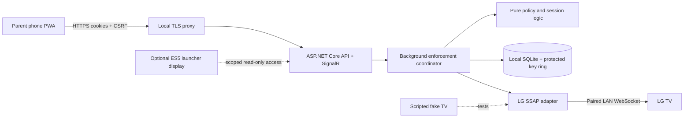

# Architecture and webOS feasibility

Status: proposed, 2026-10-23. Scope and semantics: [REQUIREMENTS.md](REQUIREMENTS.md).
Execution/handoff: [PLAN.md](PLAN.md). No parental-control implementation exists yet.

## Repository analysis and additive layout

`AGENTS.md` delegates to `CLAUDE.md`; both were read and will remain unchanged.
Existing Android is Java 8 source, no Gradle, built by `build.sh` with JDK 17+,
Android platform/build-tools 34. `web/` is shared ES5 code for older LG/Samsung
Chromium; Python standard-library packagers live in `webos/`, `tizen/`, `tools/`.
`docs/` is a separate static marketing website. `tools/check.sh` builds Android,
checks translation catalogues, packages both web targets and checks ES5 compatibility.
GitHub Actions runs these checks. There is no existing .NET/Vue/SQLite service.

Keep these paths, root build commands and upstream instructions intact. Introduce
all new runtime/build dependencies under `parental/`; do not make Android or TV web
builds depend on Node/.NET or the parental service. Vue runs on parent phones, not
in the legacy TV web runtime. Optional TV UI changes must remain ES5.

Proposed tree (only the three planning documents are added in this task):

```text
/                               # existing root/build layout stays in place
├── app/ web/ webos/ tizen/      # existing launchers, unchanged
├── tools/ .github/workflows/    # existing checks remain; add separate CI later
├── docs/parental/
│   ├── REQUIREMENTS.md
│   ├── ARCHITECTURE.md
│   └── PLAN.md
└── parental/                    # independent subsystem, future milestones
    ├── README.md
    ├── global.json              # pinned supported .NET 10 LTS SDK
    ├── Parental.sln
    ├── Directory.Build.props
    ├── Directory.Packages.props
    ├── src/
    │   ├── Parental.Core/       # policy, accounting, adapter contracts, no I/O
    │   ├── Parental.Infrastructure/ # SQLite, SSAP, encrypted credential storage
    │   └── Parental.Server/     # ASP.NET API, SignalR, worker, hosted PWA
    ├── tests/
    │   ├── Parental.Core.Tests/
    │   ├── Parental.Integration.Tests/
    │   └── Parental.WebOs.Tests/ # scripted WebSocket fake, no real TV by default
    ├── ui/                     # Vue 3, TS, Vite PWA, locked npm dependencies
    │   ├── src/
    │   └── tests/              # component and Playwright scenarios
    ├── deploy/
    │   ├── Dockerfile          # multi-stage build, UI assets in server image
    │   ├── compose.yaml        # server + local HTTPS reverse proxy
    │   ├── Caddyfile           # internal CA, no public ACME or cloud DNS
    │   └── .env.example        # non-secret examples only
    └── scripts/                # thin repeatable check/bootstrap/backup helpers
```

Runtime data is a Docker named volume under `/var/lib/parental`, outside checkout
paths. Development data belongs outside Git with explicit ignore rules in milestone 2.
Do not create all proposed files/projects until their milestone needs them. Root ignore
and a separate workflow are small intentional additions later, not an upstream rewrite.

Important: the existing Pages workflow publishes the entire `docs/` directory when
`docs/**` changes on main. These planning documents must therefore contain only public,
generic information. This task does not push, deploy or change Pages behavior.

## Capability investigation and evidence

Sources were retrieved/read on 2026-10-23. “Source-supported” means an implementation
exists in the cited source, not that it has been exercised on this household's TV.
Community endpoint use is not a supported public API contract across all LG firmware.
LG's historical SDK is useful evidence but is not a current model certification.

| Capability | Evidence and classification | Design consequence / remaining test |
| --- | --- | --- |
| Pairing/registration | Existing `web/tv.js:39`–`67` sends `register`, `pairingType: PROMPT`, optional `client-key`, stores key on `registered`. LG Connect SDK [socket implementation][sdk-socket] and community [connection implementation][py-pair] corroborate request IDs/registration. Source-supported. | Separate server identity and encrypted key store; launcher key is not reused. Validate accept/reject, revoked key, reboot persistence and minimum permission manifest. |
| WS/WSS | [aiowebostv client][aio-client] uses WS port 3000 and WSS 3001, with firmware-dependent fallback. Community-observed, not universal. | Probe only enrolled address; prefer WSS with per-TV certificate pinning. No global certificate-validation bypass. Legacy WS requires explicit parent opt-in. |
| Power observation | [Endpoints][aio-endpoints] define `com.webos.service.tvpower/power/getPowerState`; [client][aio-client] queries/subscribes. It treats Power Off/Suspend/Active Standby differently from active, and distinguishes Screen Off, with app-ID fallback on older firmware. Community evidence. | Store raw state plus normalized confidence/freshness. Subscription + bounded probes; no ping/socket-off inference. Verify each observed state on OLED. Current-app fallback alone is too weak for confirmed cooldown. |
| Standby request | LG [device service][sdk-device] implements `ssap://system/turnOff`; [PyWebOSTV controls][py-controls] and [aiowebostv][aio-endpoints] agree. Strong source evidence, untested hardware. | Normal soft standby only. Ack/disconnect is not proof of standby. Verify HDMI/apps/CEC wake scenarios and panel maintenance; no mains control. |
| Notifications | [PyWebOSTV controls][py-controls] uses `ssap://system.notifications/createToast` with message payload. Historical LG [service][sdk-device] uses a `palm://.../createToast` URI through its service layer. Source evidence, URI/permission differences matter. | Start with community SSAP route; visible physical test across inputs/apps, permission denial and DND. Unsupported warnings do not disable shutdown. |
| Reconnect/on-again | Registration, subscriptions and heartbeat exist in [client][aio-client]. A standby TV may close its socket or leave network services alive. | Re-register, request snapshot and restore subscriptions; detect active state after every reconnect. Cold boot/Quick Start+/Always Ready/LAN sleep require physical timing measurements. |
| Power-on/Wake-on-LAN | Historical LG SDK explicitly reports power-on unsupported; community clients expose other power routes. | Auto-wake is outside scope; no reliance on WOL, device discovery or wake permissions. Use reserved/manual IP. |
| Ordinary app/background | Existing launcher is an installed web app, not a privileged system service. `CLAUDE.md` already records firmware restrictions on app enumeration. LG lifecycle/service reference pages are listed below but could not be retrieved (network proxy 403). | Do not rely on launcher residency, Developer Mode SSH or a JS service as an always-on supervisor. Official lifecycle/permission details remain a documentation gate; measure suspend/termination only for optional UI. |
| Native parental locks/PIN/settings | No verified supported endpoint to administer native parental restrictions was established in reviewed sources. `ssap://pairing/setPin` in LG SDK is pairing authentication, not a parental-lock PIN API. | Unsupported for this design. Do not call guessed settings/Luna endpoints, use signed test identities to seek privileges, or promise native lock integration. Parents may manage native locks manually. |
| OLED maintenance | Soft standby leaves mains supplied; no reviewed API proves maintenance cycle status or completion. | Never power-cut, force wake or drive maintenance menus. Check the exact model's official owner manual and observe routine standby maintenance with parent consent. No claim that SSAP can monitor maintenance. |

LG developer reference pages to review when accessible (not verified here):

- https://webostv.developer.lge.com/develop/guides/app-lifecycle
- https://webostv.developer.lge.com/develop/guides/js-service-basics
- https://webostv.developer.lge.com/develop/references/luna-service-introduction

Retail webOS TV and webOS OSE are different permission environments. Availability of
an OSE Luna endpoint does not prove access from a retail web app or SSAP client.
The community pairing manifests contain broad permissions and historical test/signed
metadata: do not copy them wholesale, impersonate LG or treat a requested permission
as a granted capability. Establish the smallest honest manifest in the hardware spike.
If this cannot obtain required controls, stop and report the unsupported operation.

[sdk-socket]: https://github.com/ConnectSDK/Connect-SDK-Android-Core/blob/2f7ebbc7eb909321ff41b2c6bcdf6b0881427579/src/com/connectsdk/service/webos/WebOSTVServiceSocketClient.java
[sdk-device]: https://github.com/ConnectSDK/Connect-SDK-Android-Core/blob/2f7ebbc7eb909321ff41b2c6bcdf6b0881427579/src/com/connectsdk/service/webos/WebOSTVDeviceService.java
[sdk-trust]: https://github.com/ConnectSDK/Connect-SDK-Android-Core/blob/2f7ebbc7eb909321ff41b2c6bcdf6b0881427579/src/com/connectsdk/service/webos/WebOSTVTrustManager.java
[aio-client]: https://github.com/home-assistant-libs/aiowebostv/blob/c61d7a439d2196e33990cccbee05f0e90157fbbf/aiowebostv/webos_client.py
[aio-endpoints]: https://github.com/home-assistant-libs/aiowebostv/blob/c61d7a439d2196e33990cccbee05f0e90157fbbf/aiowebostv/endpoints.py
[py-controls]: https://github.com/supersaiyanmode/PyWebOSTV/blob/55cbd0303fd3211c4e898ae1728b934a4ca5d2aa/pywebostv/controls.py
[py-pair]: https://github.com/supersaiyanmode/PyWebOSTV/blob/55cbd0303fd3211c4e898ae1728b934a4ca5d2aa/pywebostv/connection.py

## Runtime and boundaries



One ASP.NET Core process hosts the worker, API, hub and built UI. One local SQLite
store. Local Caddy provides TLS for mobile PWA installation/service workers, which
require a secure context on LAN; bare HTTP private IP is insufficient. Parent phones
must trust the local CA and use a matching local hostname/address certificate. Existing
trusted local reverse proxy can replace Caddy. Persist proxy CA separately from app data.
Keep the app port internal in production; honor forwarded headers only from the proxy.
Expose proxy HTTPS to the LAN, no UPnP/public port forwarding or Docker socket mount.
No Redis, MQTT, broker or standalone frontend runtime is needed.

Use .NET 10 LTS, Vue 3 + TypeScript and Node 24 LTS as proposed foundation targets;
verify SDK/package compatibility and pin exact supported versions and lockfiles in M2.
Use built-in `TimeProvider`, ASP.NET Core cookie auth/Identity password hashing, SignalR
and EF Core SQLite. No .NET packages or Docker daemon capability were validated in this
planning task; SDK availability and container privileges are a foundation check.

`Parental.Core` holds pure functions/types: normalized observations, policies, usage
intervals, sessions and decisions. Evaluation takes time, policy version, accumulated
state and overrides and returns permission, reasons and next deadlines. It does not
read system clocks, DBs or sockets. Expose an `ITvAdapter` with operations for explicit
pairing, connect/disconnect, fresh state read/watch, notification and normal standby;
results include capability, observation time and error category. Avoid generic command
execution. Connection/pairing errors are distinct from unsupported capability and timeout.

`Parental.Infrastructure` implements that interface with .NET ClientWebSocket and a
scriptable WebSocket fake in tests. Bound message sizes/timeouts; correlate IDs; tolerate
unknown payload fields; ignore stale/duplicate responses; isolate connection generations.
Persist capabilities per model/firmware and revalidate after firmware changes. No Python
client runtime dependency: inspected clients are evidence, not copied implementation.

`Parental.Server` contains one coordinator per enrolled device within a single process.
Serialize state updates, policy edits, overrides and command selection for each device;
use short DB transactions and optimistic revisions for API writes. Network I/O never
holds a DB transaction open. Recheck policy/state generation before transmitting a queued
command. One instance only: a second instance must fail startup via an exclusive local
process/volume lock, rather than becoming a competing controller. UI traffic cannot
block the worker; bounded queues and priority for state/enforcement over broadcast work.

## Persistence, recovery and API

SQLite tables: Devices, PolicyVersions (weekday windows), Sessions, UsageIntervals,
DailyUsage, DeviceCheckpoints, Overrides, CommandAttempts, WarningDeliveries, AuditEvents,
and local admin authentication records. Versioned relational migrations; no full event
sourcing. Usage intervals keep UTC bounds and evidence type; daily aggregates are
transactionally maintained projections that can be checked/rebuilt from those intervals.
Unique interval/command/override IDs and idempotency keys prevent duplicate charging or
grants. Raw data, adjustments and policy versions remain distinguishable.

Record observation/checkpoint, accounted interval, warning or command intent atomically
before external actions. Persist outcome after the response. A crash between sending and
saving outcome is inherently ambiguous; recovery reobserves and reevaluates rather than
claiming exactly-once device commands. Checkpoints include last accounted instant,
session consumed seconds, cooldown continuity, warning state and current policy version.
Use UTC timestamps and explicit local-date/timezone attribution as defined in requirements.

SQLite WAL on a local named volume, foreign keys, busy timeout and short writes; select
durable synchronous settings and measure 5-second checkpoints. Persist the ASP.NET Data
Protection key ring outside the DB for cookie and pairing-token protection. Use SQLite's
backup API (or stop/checkpoint the service); copying only the live `.db` file loses WAL
state. Back up DB and key ring together with restricted permissions; test restore,
migration failure and disk-full behavior. Never silently replace a corrupt DB with empty
allowances: enter degraded/unarmed mode, expose the fault and restore deliberately.

Proposed API: `/api/auth/*`, `/api/devices`, explicit pairing start/status/revoke,
`/api/devices/{id}/policy`, `/status`, `/usage`, `/overrides`, and audited adjustments.
No raw SSAP proxy, general-purpose shell or unrestricted endpoint URL input. Version
writes and require idempotency keys for grants. Hub `/hubs/status` broadcasts authorized
status snapshots/events with monotonically increasing revisions; clients fetch a current
snapshot after reconnect or missed sequence. API and hub use the same authorization.
Liveness checks process health; readiness reports store/worker readiness separately from
TV reachability. Unreachable TV remains a visible device fault, not a false Off/healthy.

Security details and offline-PWA behavior are requirements, not optional polishing.
WSS self-signed certificates need explicit enrollment trust/pinning and a visible
certificate-change recovery flow, similar in principle to [LG's trust manager][sdk-trust].
Do not copy the community client's `ssl=False`. Initial trust is still trust-on-first-use:
parent confirms enrollment on a trusted LAN; pinning prevents silent later substitution,
not a first-contact attacker. Plain WS fallback exposes the pairing token and requires D4.

## Physical OLED validation gate

Before arming real enforcement, record model/year/firmware, timezone, transport,
network settings and parent-approved policy. Parent must explicitly authorize pairing,
notifications and standby tests; read-only research does not authorize changing the TV.
Never capture keys, unredacted frames, household IPs or personal data in committed fixtures.

1. Review official lifecycle, permission and exact-model maintenance documentation;
   record dated links and distinguish documentation claims from measured behavior.
2. Pair with a minimal manifest over WSS; test rejection, re-registration after restart,
   key revocation, certificate pin change and unsupported permission responses.
3. Observe power states through native apps, live TV, HDMI, screen-off/audio-only,
   normal standby, Quick Start+ and Always Ready (only settings the parent permits).
   Measure freshness, subscription delivery, boot detection and whether standby
   remains positively observable long enough to establish cooldown.
4. Send a harmless countdown toast on each input; record acknowledgement vs actual
   visibility and failure modes. Ask before soft standby; verify normal shutdown,
   subsequent remote/CEC power-on detection and absence of command storms.
5. Leave mains connected. Check owner-manual behavior and parent observation of routine
   OLED compensation without forcing a cycle or waking the TV during maintenance.
6. Disconnect LAN/server and restart containers during a session/cooldown, then reconnect;
   confirm uncertainty accounting, stale-command cancellation and honest status.
7. Write a sanitized compatibility record. If standby cannot be observed, D2 must be
   revisited with the parent before shipping: choose audited manual reconciliation or
   explicitly weaker cooldown evidence. Do not silently promote socket loss into proof.

Main risks: firmware endpoint/permission changes; standby ambiguity; unsupported power
subscriptions; no offline enforcement; conservative accounting usability; local-CA phone
trust; SQLite/key-ring loss; clock/DST errors; server downtime; CEC immediate reactivation.
The simulator addresses software correctness; only the physical gate addresses TV
compatibility. Optional launcher integration is deferred and has no administrative
credential embedded in its package. Public APIs for native locks remain unverified and
outside scope unless a supported retail-TV contract is later demonstrated.
